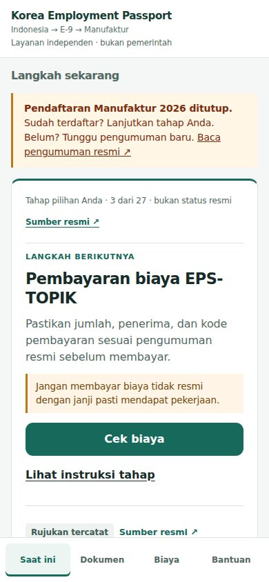
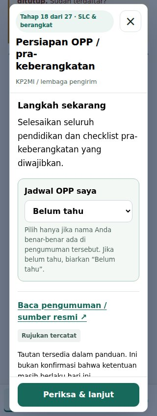
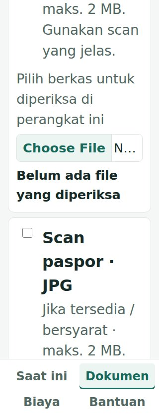
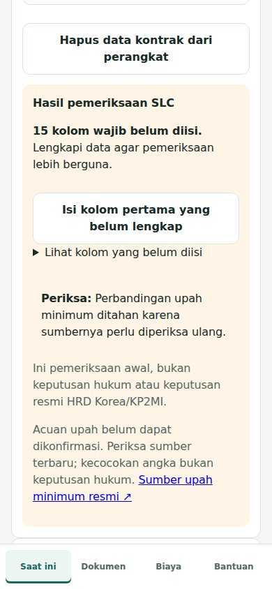

# KEP 사용자 피드백 전 개선·검증 기록

기준일: 2026-10-30 KST. 이 문서는 이전 `UI_REDESIGN_REVIEW_2026-10-30.md` 이후의 최신 기록이다. 기능·출처 데이터는 보존했고, 사용자 피드백 없이 재현할 수 있는 문제를 수정했다. 운영 출시 승인은 아직 없다.

## 이전 작업 확인

main과 #326의 최초 전체 검사는 모두 46/56으로 같은 10개가 실패했다. 테스트 fixture·OTP mock·오래된 URL/기대값·서버 격리를 #327에서 수정하고, 모바일 홈→단계 안내→출처→팝업→화면 보완을 #328~#332로 분리했다. 해당 당시 85/85 및 49개 화면 검토 기록은 이전 보고서에 보존되어 있다. 이번 기록의 새 결과와 혼합하지 않는다.

## 완료한 개선

| PR | 변경 | 원격 head |
|---|---|---|
| #333 | 오래된 문구 일치 검사를 실제 표시되는 출시 조건 검사로 변경; 안전 조건 유지 | `3eb3bf09a7fb16c2f75cd3e80271d650f97bd15a` |
| #334 | 입력 라벨·오류 연결·포커스·랜드마크; 자동 접근성 검사 | `7229c2487458187b64a0328b5235966627bc11c5` |
| #335 | 팝업 상단 공고 선택, 도구별 화면 집중, 현재 단계 복귀 | `0d52d1d4e77c402449c4696ee72133a66593701e` |
| #336 | 공개 홈·베타·개인정보·국가 화면 통일; 가짜 23% 진행률 제거 | `99520c7d85dd0f3da654f1f3382230456dcb505d` |
| #337 | KEP 캐시만 정리, 비공개/실패 응답 저장 방지, 오프라인 복구, 설치 버튼 대비, HTML 구조 | `d6fcaf75950aebb0f6581f19380dde4cd3092343` |
| #338 | 인도네시아어 표시 문구, 320px·200% 글자 확대, 추가 진단 기록·UTF-8 수정 | `58232e6cf887061a96e3f4291f697d7c7c4c5068` |
| #339 | 불확실한 출처의 자격·비용·임금 판단 보류, 오래된 결과 숨김, 참가자별 계약 초기화 | `1bd5a30dbaaa86a4b16317b1d6cbf452e30cdc37` |
| #340 | 실제 화면에서 확인한 200% 메뉴 단어 잘림과 반복 계약 미입력 경고 정리 | `67132fa05293626154ccb1d36979969788271ff8` |

모두 별도 브랜치의 Draft PR이다. #333은 #332 위, 이후 순차 스택이다. #339는 #338에 추가된 진단 문서와 UTF-8 수정을 보존하는 병합 커밋을 포함한다. 공식 출처 JSON·원문 URL·원래 수치 및 계산 기능을 임의로 갱신하지 않았다.

## 검증 결과와 재현 범위

- 클라우드 Linux Chromium / Playwright 1.55.0: **135/135 PASS**, skip 0, flaky 0, retries 0, workers 1, 기본 30초 테스트 제한 유지. `pre-feedback-ui-results.json`에 모든 사례·명령·실행 SHA 기록.
- 검사 당시 로컬 head `5d0527187c793c992dfdd2339fa587fb31c1782e`; #340의 제품 코드와 동일하며 화면별 접근성 spec 분리를 포함한다. 이후 차이는 접근성 감사 스크립트의 오류·결과 상태 추가, 실행기의 중단 상태 기록, 문서·검증 기록·캡처뿐이다. 최종 증거 커밋 전체를 동일 SHA로 재실행했다고 주장하지 않는다.
- static-check.yml의 30개 명령 단계를 클라우드 셸에서 실행: **30/30 PASS**. GitHub Actions를 호출하지 않았다. 이 중 출시 사전 검사는 명시적인 `--allow-source-review-pending` 모드이며 strict 출시 승인과 다르다.
- 안내문 계약 자체 검사 **5 PASS**, HTML 구조 **23개 PASS**, DOM/데이터 연결 검사 PASS. 27단계·13서류팩·308정확답변·256질문·8폼·113필드 유지.
- 이전에 시간초과한 공고 질문·worker intake 2개 시나리오를 각 5회 직렬 실행: **10/10 PASS**. 이 반복은 이전 제품 스냅샷 검사이며 최신 전체 실행의 대체 증거로 사용하지 않는다.
- `run_cloud_ui.py`: Git 공용 디렉터리 잠금으로 worktree 간 중복 실행 차단, 시도별 JSON·trace·로그 분리, Chromium 사전 실행 확인. 잠금 검사 PASS. Colab의 중복 사전 HTTP 서버 시작을 제거하고 Playwright가 서버를 소유하게 했다.

## 실패 이력 보존

`pre-feedback-run-history.json`에 원래 오류를 기록했다. 통과 결과로 덮어쓰지 않았다.

1. 이전 85개 실행의 일시 시간초과는 기존 `ui-timeout-observation-2026-10-30.json`에 보존.
2. 추가 개선 중 103/104 실행에서 worker intake checkbox 클릭 시간초과. 직렬 재검사는 통과했으나 역사적 시간초과의 단일 근본 원인은 확정하지 못했다.
3. 마지막 소스 가드 추가 직후 108/109: 테스트가 필수 한국 근무 연수를 비워서 입력 불완전 화면을 받음. 제품의 입력 검증은 정상. 테스트에 0년을 명시하고 최신 109/109 전체 실행 통과.
4. 세션 재개 후 Chromium 캐시가 없는 상태의 실행: 7 PASS/102 FAIL, 브라우저 시작 불가. 캐시 설치를 복구하고 실행기 사전 검사를 추가했으며, 다음 전체 실행이 109/109 통과. 제품 회귀로 분류하지 않는다.
5. 화면 최종 보완의 첫 전체 실행 110/111: 320px 기본 글자 메뉴가 두 줄이 되어 CTA를 가림. 메뉴 최소 너비를 수정했으며 DOM 검사가 지적한 동적 버튼 참조도 결과 영역 안에서 조회하도록 수정.
6. 다음 실행은 13개 상태를 한 번에 감사하던 접근성 테스트가 30초를 초과했고, 이후 정체되어 명시적으로 중단(exit 130). 전체 통과 수를 추정하지 않는다. 같은 26개 상태를 각 독립 테스트로 나누고 30초 제한·검사 태그·위반 0개 기준을 유지했다.
7. 별도 Windows 진단 91/104 이후 10개·5개 분리 재검사 통과 기록은 `LATEST_UI_FULL_SUITE_RECHECK_2026-10-30.md`에 그대로 유지했다. 현재 클라우드 결과와 혼합하지 않는다. 이번 이어서 작업에서는 Windows나 개인 장치를 조작하지 않았다.

원래 111개에서 13개 상태를 한 번에 실행하던 접근성 테스트 2개를 동일 범위의 독립 테스트 26개로 나누어 최종 135개가 되었다. 테스트 삭제·위반 기준 완화·제한 시간 증가 없이 각 상태의 실패 위치를 분리했다.

## 출시 차단 조건과 남은 검증

**strict `check_beta_launch_readiness.py` FAIL**:

- 저장된 공식 출처 상태 `review_required` (clean 아님).
- 84개 중 83개만 확인된 상태.
- reviewRequiredUrls가 비어 있지 않음.
- fetchFailureUrls가 비어 있지 않음.

출처 기록은 과거 모니터 결과이며 실시간 최신성으로 표시하지 않는다. URL 열림 확인만으로 법령·공고 내용 승인을 대체하지 않는다. Indonesia Manufacturing 최종 서류 공고 exact HOLD 유지. 출처 원문 차이·적용 범위의 사람 검토, 현지 원어민 문구 검토, 실제 Android/iOS 가상 키보드·스크린리더·설치/업데이트 검증, 독립 사용자 과업 평가, 동일 후보 HTTPS staging 자산 검사와 디자인 승인이 남아 있다.

main 병합·운영/스테이징 배포·beta OPEN·GitHub Actions 실행 없음. 물리 단말 검증을 viewport 에뮬레이션으로 대체 완료 처리하지 않았다. 상용 수준의 최종 디자인 승인을 선언하지 않는다.

## 화면 검토

1차 30개 캡처에서 200% 메뉴가 단어 중간에서 줄바꿈되고, 계약 미입력 결과가 같은 경고 패턴을 반복해 출처 경고를 밀어내는 문제를 발견했다. #340에서 메뉴를 완전한 단어 단위 2행으로 재배치하고 실제 높이만큼 콘텐츠 하단 여백을 확보했다. 계약 미입력은 개수 요약·첫 항목 이동·전체 목록 펼침으로 정리했다. 스크린샷은 이 최종 상태로 다시 생성했다.

상용 수준 판단은 실제 화면의 위계·일관성·명확성·오류 회복을 기준으로 한다. 현재 단계/한 개의 다음 행동/공식 출처가 보이는 홈, 공고 선택이 첫 화면에 노출되는 팝업, 입력과 연결된 오류 표시, 부풀린 진행률 없는 공개 화면은 검토 가능한 수준으로 개선되었다. 다만 장문의 공식 안내와 법적 맥락은 원문 정보량을 유지하며, 실제 사용자의 이해도와 과업 성공률을 확인하기 전 최종 상용 완성으로 판정하지 않는다.

최종 실제 화면 확인 결과:

| 기준 | 실제 확인 | 판정 |
|---|---|---|
| 홈 우선순위 | 320~1280px에서 선택 단계·주 행동·공식 출처 확인, 320px 주 버튼이 하단 메뉴 위에 노출 | 통과 |
| 팝업 | 320px 첫 화면에서 개인 공고 선택과 공식 출처 이동, 닫기·하단 행동 유지 | 통과 |
| 오류·복구 | 입력 라벨과 연결된 오류 및 첫 오류 포커스, 계약 미입력 요약·첫 항목 이동 | 통과 |
| 확대·스크롤 | 320x568 / 200% 텍스트에서 모든 도구 마지막 행동 도달, 메뉴 단어 유지 | 통과 |
| 시각 일관성 | 공개 홈·개인정보·베타와 앱의 녹색·중립색·타이포그래피 일치, 가짜 진행률 제거 | 검토 가능한 일관성 확보 |
| 사용자 이해·신뢰 | 독립 사용자 과업 수행, 현지 문구·실제 단말 검증 없음 | 최종 승인 보류 |

- 접근성 자동 감사: **40개 상태 / 위반 0개**, axe-core 4.10.3. 미확정(incomplete) 기록 16개는 별도로 보존했다. 자동 검사는 WCAG 적합성이나 스크린리더 실사용 승인이 아니다.
- 화면 캡처: **30개**, 폭 320/360/375/390/430/768/1280, 문서 전체 너비 초과 0, pageerror 0. 캡처는 클라우드 Chromium viewport 에뮬레이션이며 실제 스마트폰이 아니다. 결과 JSON에 상태별 치수와 오류를 기록했다.
- 홈·문서·공고 팝업 각 7개 폭, 320px 오류/200% 문서, 390px 계약 결과, 공개 홈·베타·개인정보 각 390/1280px을 포함한다.
- `pre-feedback-file-inventory.json`에 #332 이후 모든 변경 파일·해시와 제품 PR 커밋을 기록했다. 이번 최종 검증 PR은 실행기·테스트·문서·증거만 추가하며 제품 변경은 #340까지다.

### 최종 캡처 예시

## 변경 파일

제품·검증 코드 파일 (#332 이후):

- `docs/app-runtime.js`
- `docs/app-shell.css`
- `docs/app.html`
- `docs/beta.css`
- `docs/beta.html`
- `docs/countries.html`
- `docs/index.html`
- `docs/privacy.html`
- `docs/readiness.html`
- `docs/styles.css`
- `docs/sw.js`
- `package-lock.json`
- `package.json`
- `scripts/audit_ui_accessibility.js`
- `scripts/capture_pre_feedback.js`
- `scripts/check_beta_launch_readiness.py`
- `scripts/check_html_structure.py`
- `scripts/release_copy_contract.py`
- `scripts/run_cloud_ui.py`
- `scripts/run_colab_ci.sh`
- `scripts/test_cloud_ui_lock.py`
- `scripts/test_release_copy_contract.py`
- `tests/accessibility.spec.js`
- `tests/contract-source-guards.spec.js`
- `tests/final-screen-readability.spec.js`
- `tests/install-control.spec.js`
- `tests/offline-cache.spec.js`
- `tests/public-surfaces.spec.js`
- `tests/responsive-reachability.spec.js`
- `tests/tool-navigation.spec.js`
- `tests/ui-copy.spec.js`

문서·원시 결과·스크린샷 30개를 포함한 전체 파일과 SHA-256은 [파일 목록](pre-feedback-file-inventory.json)에 있다. 공식 데이터 diff는 0이다.
