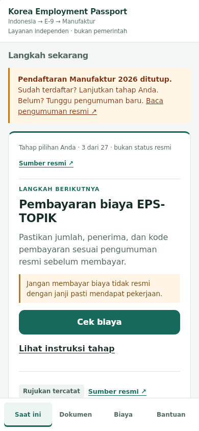
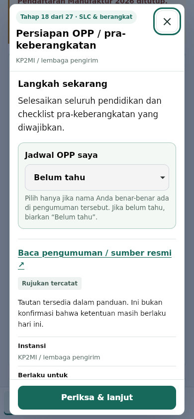
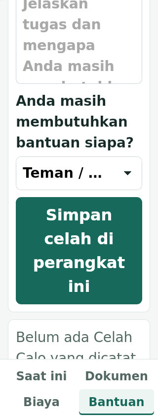
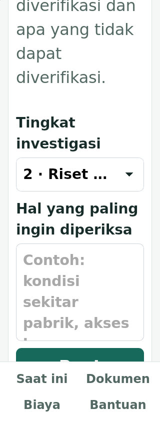

# KEP 모바일 브라우저·키보드 후속 검증

기준일: 2026-10-30 KST. [이전 135개 Chromium 검증](KEP_PRE_FEEDBACK_REVIEW_2026-10-30.md) 이후, 다른 렌더링 엔진과 키보드 이동에서 빠진 범위를 확인한 기록이다. 물리 단말 테스트·출시 승인과 구분한다.

## 발견한 결함과 수정

첫 사용 단계 선택, 현재 과업, 도구 화면, 최초 데이터 로드 실패 화면에서 키보드 사용자가 본문으로 바로 이동할 수 있어야 한다. 기존 skip link는 항상 `#nextAction`을 가리켜, 그 영역이 숨겨진 화면에서는 이동하지 못했고 포커스도 옮기지 못했다.

- 수정 전 새 재현 검사 0/3 PASS, 3 FAIL.
- #342 (`62150901d045142a0de24173d2a2ae7bda44535d`): 표시 중인 설정·도구·복구·현재 과업에 맞게 링크 대상/이름을 동기화하고 키보드 포커스를 이동한다. 입력과 진행 데이터는 유지한다.
- 수정 후 같은 검사 3/3 PASS. 최초 잘못된 worktree에서 실행한 명령은 수집 사례 0개로 종료되어 증거로 사용하지 않는다.

## WebKit에서 추가 발견한 확대 결함

첫 WebKit 전체 실행은 **141/142 PASS, 1 FAIL**이었다. `gaps` 화면의 320x568 / 200% 확대 검사에서 가로 넘침을 검출했다. 별도 DOM 측정으로 `companyHub`도 확인했다. 컨테이너 288px에 scrollWidth가 각각 375px·439px이었다.

긴 option이 있는 WebKit select가 겉보기 경계는 맞아도 overflow를 visible로 유지하는 원인이었다. min-width 조정만으로 해결되지 않았다. #343 (`10b434ca9c97d684ef12b789f67a871fcaef60e3`)에서 의미를 가진 기본 `<select>`를 보존하고, 외형/말줄임/선택 화살표만 CSS로 조정했다. 전역 페이지 잘라내기나 option 삭제로 숨기지 않았다. 강제 색 모드에서는 시스템 외형을 유지한다.

수정 후 8개 확장 도구에서 컨테이너 너비를 넘지 않았다. 선택 값 변경·전체 선택 항목 텍스트·키보드 포커스를 포함한 WebKit 집중 검사 **4/4 PASS**. DOM 원시 측정은 `webkit-select-diagnosis.json`, 전체 첫 실패는 `browser-parity-run-history.json`에 보존한다.

## 추가 검증 범위

`tests/mobile-viewport.spec.js`의 5개 사례는 320/390px에서 입력 중 레이아웃 viewport가 낮아진 경우의 입력/행동 접근성, 팝업 닫기·완료 버튼 노출, 브라우저 Back→Forward 재개와 진행 데이터 보존을 검사한다. OS 가상 키보드 자체를 재현했다고 주장하지 않는다.

`KEP_BROWSER=chromium|webkit|firefox`로 동일 테스트를 실행할 수 있게 했고, 실행기는 선택한 엔진을 실제로 사전 실행하며 결과에 엔진을 기록한다. WebKit에는 모바일·터치 에뮬레이션을 적용한다. 기본 Chromium 실행은 기존과 동일하다.

- Chromium 140.0.7339.16 / build 1187: 기존 전체 + 새 9개 = 144개.
- WebKit 26.0 / build 2203: 모바일·터치 에뮬레이션, 적용 가능한 143개.
- Firefox 141.0 / build 1490: viewport 기반 검사, 적용 가능한 143개.
- WebKit/Firefox에서 제외한 한 사례는 `offline-cache.spec.js`다. 내부 worker 열거·스크립트 주입은 설치된 Playwright 타입 문서에서도 Chromium 전용으로 명시된 API다. Chromium에서는 이 실제 worker 검사를 유지한다. 다른 엔진의 오프라인/PWA 실사용을 검증 완료 처리하지 않는다.
- beforeinstallprompt 검사는 이벤트 mock에 대한 UI 검사이며, 실제 설치 성공 증거가 아니다.
- 동일 검사 태그/판정 기준, worker 1, retries 0, 기본 테스트 제한 30초를 유지한다.

## 클라우드 실행 환경

개인 Windows PC/휴대폰을 사용하지 않았다. 이 제한된 클라우드에서 기본 OS 의존성 설치는 UID 변경 권한 오류로 실패했다. 필요한 Ubuntu 패키지를 download-only로 내려받아 임시 폴더에 추출했고 시스템 패키지 설치는 하지 않았다.

WebKit 배포본의 실행 wrapper가 기존 LD_LIBRARY_PATH를 덮어써, 임시 라이브러리 경로를 상속하도록 캐시의 launcher 한 줄을 변경했다. 브라우저 바이너리나 제품 코드는 이 조치로 변경하지 않았다. ldconfig 캐시만 보는 Playwright 의존성 검사에는 임시 경로가 등록되지 않으므로 `PLAYWRIGHT_SKIP_VALIDATE_HOST_REQUIREMENTS=1`을 명시했다. 실제 라이브러리 로딩과 브라우저 사전 실행을 통과한 뒤 테스트를 시작했다. 이 예외는 출시 안전 검사나 UI 단언을 우회하는 것이 아니다.

정상적인 Colab/전용 Linux 환경에서는 `npm ci`와 `npx playwright install --with-deps chromium webkit firefox` 후 엔진별 실행을 사용할 수 있다. 본 실행의 선택 엔진·실제 명령·제품 소스와 동일한 검사 SHA·제외 범위는 원시 결과 요약에 남긴다.

## 결과

최신 제품 소스는 #343과 동일하다. 전체 UI 검사는 로컬 `68d3a3761ed9bd3fdd3cc2b31b0b0c44a979d0ba`에서 실행했으며 이후 변경은 Colab의 엔진 선택 검증과 기록·캡처뿐이다. 최종 증거 커밋 전체를 같은 SHA로 재검사했다고 주장하지 않는다.

| 검사 | 실제 결과 |
|---|---|
| Chromium 전체 | **144/144 PASS**, retries/skipped/flaky 0 |
| WebKit 모바일·터치 전체 | **143/143 PASS**, retries/skipped/flaky 0 (명시 제외 1개) |
| Firefox | **미검증** — 실제 renderer 사전 검사 exit 3, 사례 시작 없음 |
| static 명령 단계 | **30/30 PASS**, Actions 미사용 |
| HTML 구조 / 안내문 계약 자체 검사 | **23개 PASS / 5 PASS** |
| strict 출시 검사 | **FAIL** — 기존 공식 출처 4개 차단 조건 유지 |

최종 원시 사례·시도·SHA는 `browser-parity-*-results.json`, 최초 실패/환경 제약은 `browser-parity-run-history.json`, skip link 전후는 `keyboard-skip-regression-2026-10-30.json`에 있다. Colab은 선택한 엔진만 설치하며 잘못된 엔진을 패키지 설치 전에 거절하는 검사도 통과했다.

## Firefox 확인 범위

현재 제한된 클라우드에서 Firefox 141.0 프로세스 시작은 가능했지만, 사이트를 요청하지 않는 빈 페이지 생성 단계에서 정체했다. 최소 재현에서도 같은 현상을 확인했다. 8개 진단 테스트 실행은 사례 시작 전 정체되어 중단(exit 130)했고, 통과 수를 추정하지 않았다. 원인을 앱 오류로 단정하지도 않았다.

실행기 사전 검사를 실제 page 생성·setContent까지 확장하고 15초 내부 제한/25초 프로세스 제한을 두었다. Firefox는 이 사전 검사에서 exit 3, 테스트 시작 없음으로 기록했다. UI 검사 제한 30초나 재시도 0회는 바꾸지 않았다. **Firefox 미검증**이며 정상 Linux/Colab 환경에서 다시 확인해야 한다.

## 출시 제한

공식 데이터는 변경하지 않았다. strict 출시 검사의 review_required / 83 of 84 / reviewRequiredUrls / fetchFailureUrls 조건을 유지한다. 원문 차이의 사람 승인, 현지 문구·사용자 과업 평가, 실제 Android/iOS 키보드·스크린리더·PWA, 같은 후보의 HTTPS staging·디자인 승인은 남는다. GitHub Actions 실행, main 병합, staging/운영 배포, beta OPEN 없음.

## 변경 파일과 커밋

- #342: `docs/app-runtime.js`, `tests/skip-navigation.spec.js` — `62150901d045142a0de24173d2a2ae7bda44535d`.
- #343: `docs/app-shell.css`, `tests/native-select-reflow.spec.js` — `10b434ca9c97d684ef12b789f67a871fcaef60e3`.
- 후속 검증 PR: `playwright.config.js`, `scripts/run_cloud_ui.py`, `scripts/run_colab_ci.sh`, `scripts/capture_browser_parity.js`, `tests/mobile-viewport.spec.js`, 최신 인계 포인터와 QA 결과·실제 화면.
- 전체 파일·SHA-256과 원본 데이터 diff 0은 `browser-parity-file-inventory.json`에 기록한다. 모든 PR은 Draft이며 부모 PR 위에 순차 스택이다.

## 실제 화면 평가

Chromium/WebKit의 실제 렌더링을 기준으로 홈의 현재 단계·한 개의 다음 행동·공식 출처, 공고 선택 팝업과 닫기, 200% 글자 확대의 메뉴·서류·긴 선택 값을 검토한다. 사진/목업으로 완료 판정하지 않는다. 이번에 발견한 키보드 이동과 WebKit 확대 결함을 수정했지만 현지 사용자 이해도, OS별 실제 입력/설치/접근성을 확인하기 전 상용 완성 승인은 보류한다.

### 최종 렌더링 확인

- Chromium/WebKit 각 6개, 총 **12개 실제 캡처**. 390px 홈·문서·공고 팝업, 320px/200% 문서·도움말 선택·회사 조사 선택을 확인했다. 문서 너비 초과 0, pageerror 0. Firefox 캡처는 포함하지 않는다.
- 선택 값은 테스트용 예시이며, 실제 문의·신청·결제를 실행하지 않았다. 긴 선택 값은 좁은 입력 상자에서 말줄임되지만 전체 option 텍스트·값과 원래 선택 기능을 보존했다.
- Chromium 확장 접근성 감사 **40개 상태, 위반 0개**, incomplete **22개**. 자동 감사로 판단할 수 없는 항목은 원시 JSON에 보존했으며 WCAG 인증이나 실기기 스크린리더 승인으로 간주하지 않는다.
- 실제 화면 기준으로 홈/팝업의 위계와 확대된 입력 영역의 일관성은 개선됐다. 최종 상용 서비스 승인과 운영 반영은 아직 아니다.

