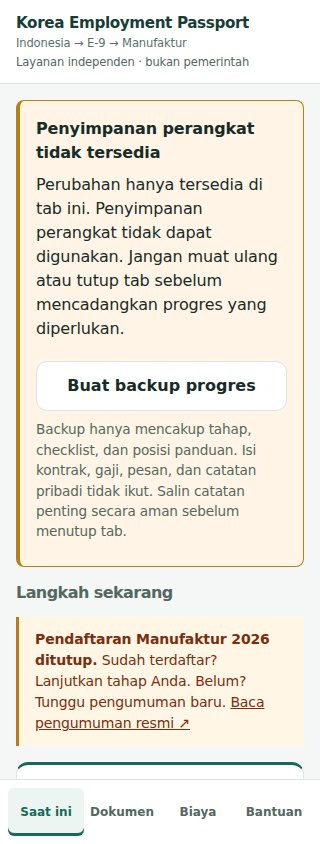
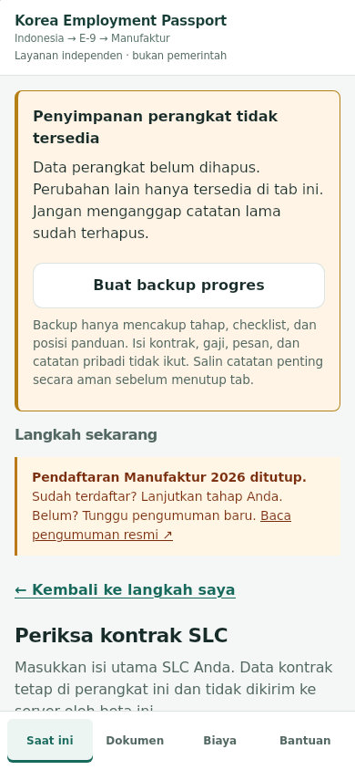
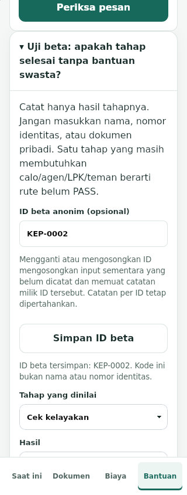
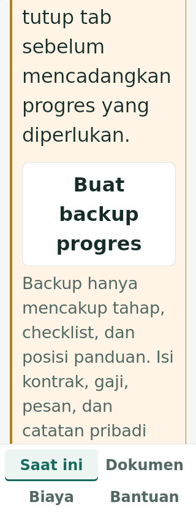

# KEP 참가자 전환·저장 오류 복구 검증

최종 갱신: 2026-10-31 KST (2026-10-30 검증의 후속). [이전 브라우저 검증](MOBILE_BROWSER_PARITY_REVIEW_2026-10-30.md) 이후의 최신 기록이다. 원격 #344 head `72fd80ec6d05c4841714c0435c118cfd14bb62e8`, #343 head `10b434ca9c97d684ef12b789f67a871fcaef60e3`가 Draft·미병합인 상태를 먼저 확인했다.

## 실제 발견한 문제

### 참가자 전환 (#345)

ID를 바꾸면 저장 공간의 namespace는 바뀌지만 계약·급여·사업장 입력, 현재 단계와 임시 결과는 이전 참가자의 것이 남았다. URL의 이전 beta ID도 새로고침 시 다시 적용됐다.

- 최초 기능 시나리오 3개 중 1 PASS / 2 FAIL. 이후 안내문 연결과 새 참가자의 편집 흐름 검사를 추가했다.
- 실제 ID 변경/해제 시 임시 입력·결과·일치 검사 상태를 초기화하고 새 ID에 해당하는 진행·서류·계약·급여·사업장·비용·질문 목록을 다시 그린다. 저장된 각 ID의 기록은 삭제하거나 복사하지 않는다.
- URL의 beta ID를 현재 선택으로 바꾸고 이전 stage 매개변수를 제거한다. src 등 다른 매개변수는 보존한다.
- 브라우저 앞으로 가기로 과거 안내를 열면 이전 beta ID가 URL에 돌아오는 추가 문제도 1 FAIL로 재현했다. 과거 안내를 다시 열어도 현재 선택한 ID와 기록을 유지하고 새로고침으로 이전 참가자로 되돌아가지 않도록 했다. 이 검사를 다섯 번째 참가자 회귀 시나리오로 추가했다.
- 같은 ID를 다시 저장하면 임시 초안을 지우지 않는다. 변경 전에 임시 입력 초기화 설명을 입력과 연결해 보여 준다.
- 처음 전체 검사에서는 153/154 PASS, 1 FAIL이었다. 새 ID에 진행 기록이 없을 때 제가 추가한 초기화 처리가 ID 편집 화면을 숨기는 회귀가 잡혔다. 테스트를 약화하지 않고 편집 화면을 유지하도록 수정했다. 홈으로 돌아갈 때 그 참가자의 단계 선택을 요청하며, 완료 상태를 임의로 기록하지 않는다.
- 원격 head: `4627d2de2efe28fd7ac81417c1d82c7b4bee661f`.

베타 ID는 로컬 기록의 문맥이며 회원 인증이나 접근 통제를 새로 구현한 것이 아니다. 회원 게시판의 서버 인증 fail-closed 조건은 유지했다.

### 저장 용량/권한 오류 (#346)

QuotaExceededError·SecurityError를 주입한 두 재현은 기존 코드에서 모두 실패했다. 단계 변경이 중단되거나, 복원 중 일부 키만 바뀌고 오류가 발생할 수 있었다.

- 저장/읽기를 사용할 수 없으면 변경을 현재 탭의 참가자별 메모리에 보관한다. 모든 정상 저장이 성공했다고 표시하지 않고 “현재 탭에서만 사용 가능” 상태를 지속해서 보여 준다.
- 진행 백업은 기존 개인정보 제한을 그대로 사용한다. 단계·서류 체크리스트·공고 선택·폼 위치만 포함한다. 계약 내용, 급여, 메시지, 개인 메모는 내보내지 않는다. 이런 입력은 탭을 닫기 전에 사용자가 안전하게 별도 보관해야 함을 명시했다.
- 복원 중 오류가 나면 해당 참가자의 변경된 진행 키만 되돌린다. 공간을 확보하려고 기존 키를 삭제하지 않는다. 되돌리기도 차단되면 이전 진행을 현재 탭에 보존하고 백업으로 복구할 수 있게 하며, 기기 상태가 부분 변경됐을 수 있음을 알린다. 모든 오류에서 기기 저장소의 원자성을 보장한다고 주장하지 않는다.
- 임시 복원 후 자동 새로고침을 하지 않아 복구한 메모리 상태를 잃지 않는다. 저장 환경이 회복돼도 임시 변경을 자동으로 기기에 재생하지 않는다.
- 삭제가 차단되면 지워졌다고 처리하지 않고 기록을 남겨 둔다. 명시적인 삭제 재시도가 성공하면 이전 실패 표시를 갱신한다.
- 정상 저장 경로, 공식 규칙/출처 데이터, 기존 백업 스키마는 유지했다.
- 원격 head: `bdca33cff1de19acaf6db5fcaeeb0e020294d513`.

## 최신 실제 검증

| 검사 | 결과와 범위 |
|---|---|
| Chromium 전체 | **156/156 PASS**, skip/flaky/retries 0, worker 1 |
| WebKit 모바일·터치 집중 검사 | **12/12 PASS**, 참가자 전환 5개 + 저장 복구 7개만 실행. 최신 전체 WebKit 통과라고 주장하지 않는다. |
| static-check.yml의 명령 단계 | 클라우드 셸에서 **30/30 PASS**, Actions 호출 없음 |
| HTML / DOM 계약 | **23개 HTML PASS**, 230 IDs / 9 views / 27 stages / 13 packs / 308 answers / 256 questions / 8 forms / 113 fields |
| 안내문 계약 자체 검사 | **5 PASS** |
| 정상 상태 접근성 감사 | Chromium **40개 상태, 위반 0, incomplete 22** (앞으로 가기 처리 추가 전 실행, 해당 수정은 화면 구조를 변경하지 않음) |
| 저장 오류 접근성 | 320x568 저장 오류 상태의 전체 axe 감사 위반 0, Chromium 전체 및 WebKit 집중 검사에 포함 |
| 렌더링 캡처 | **12개**, Chromium/WebKit, 320/390px. 페이지 오류·문서 너비 초과 0. 320px/200%에서 백업 버튼이 하단 메뉴 위에 도달함도 확인. |
| strict 출시 검사 | **FAIL**, 기존 공식 출처 4개 차단 조건 유지 |

전체/집중 검사는 로컬 `2d37f3a274033ed739c9b5e229413f12ae84adfd`에서 실행했다. 이 소스는 #346과 동일하다. 이후에는 캡처 스크립트·문서·증거만 추가했다. 최종 증거 커밋 전체를 같은 SHA로 재실행했다고 주장하지 않는다. 잠금 자체 검사 1회는 실행 중인 WebKit 검사와 겹쳐 BlockingIOError로 종료됐다. 제품/UI 실패로 합산하지 않고, 브라우저 검사가 끝난 유휴 상태에서 다시 확인한 결과를 정적 증거에 별도 기록했다. 최초 브라우저 실행은 제거된 캐시 때문에 사전 검사에서 종료됐으며 테스트 실패/통과로 집계하지 않았다. 고정된 브라우저 버전을 다시 내려받은 뒤 실제 실행했다.

156개는 기존 144개에 참가자 전환 5개와 저장 복구 7개를 더한 수다. 기존 수동 ID 전환 검사는 변경하지 않았고, 회귀를 수정한 후 통과했다. 테스트 제한 30초와 재시도 0회를 유지했다. 첫 집중 검사 8/8, 모바일/복원 추가 10/10, 회귀 수정 집중 12/12 및 최초 153/154 실패는 `storage-run-history.json`에 분리 보존했다. 원시 사례와 실제 실행 옵션은 `storage-chromium-results.json`, `storage-webkit-focused-results.json`에 있다.

## 실제 화면 평가

정상 화면은 기존 단계·다음 행동·공식 출처의 위계를 유지한다. 오류 상태에서는 저장 범위와 가능한 다음 행동을 먼저 보여 준다. 320px에서 경고/백업 버튼이 읽히고, 200% 글자 확대 시 버튼이 메뉴에 가려지지 않는 것을 실제 화면으로 확인했다. ID 편집에서도 초기화 설명을 읽고 같은 화면에서 ID를 바로 고칠 수 있다.

경고가 없는 정상 상태와 오류 상태 모두 실제 브라우저에서 확인했지만, 상용 완성 승인으로 간주하지 않는다. 스크린리더·OS 키보드·실제 설치 동작·현지 문구/사용자 이해도 검증은 남는다. 오류 시험과 캡처의 모든 데이터는 격리된 컨텍스트의 가상 데이터이며 실제 고객 저장소나 실제 연락·신청·결제를 사용하지 않았다.

## Firefox 진단

이전 “프로세스는 뜨지만 빈 페이지를 열지 못함”을 새 클라우드 세션에서도 재현했다. DEBUG 로그에서 콘텐츠 프로세스의 `/proc/self/uid_map` 쓰기 EPERM과 signal 11 종료를 확인했다. 앱을 요청하기 전 실패 경로이며 Firefox 앱 호환성 통과/실패로 분류하지 않는다. 발췌는 `firefox-native-failure-excerpt.txt`에 있다.

호스트의 권한이나 Firefox 보안 설정을 낮춰 통과 처리하지 않았다. **Firefox는 계속 미검증**이며 호환되는 별도 클라우드 환경에서 확인해야 한다. Windows PC·휴대폰을 조작하지 않았다. WebKit은 이전 기록과 동일하게 추출된 라이브러리 경로를 상속하는 테스트 launcher를 사용했고 실제 renderer 사전 검사를 통과했다.

## 미해결·출시 상태

- 공식 출처의 저장 상태 review_required, checked 83/84, reviewRequiredUrls 존재, fetchFailureUrls 존재. 과거 모니터 상태이며 오늘의 원문 승인으로 표시하지 않는다.
- Indonesia Manufacturing 최종 서류 exact HOLD 및 회원 backend fail-closed 유지.
- 원문 내용·적용 범위 승인, 원어민/독립 사용자 과업 평가, 실제 Android/iOS·스크린리더·PWA, 같은 후보의 HTTPS staging·디자인 승인 미완료.
- main·공식 데이터 변경 없음. Draft PR만 생성했으며 main 병합, staging/운영 배포, beta OPEN, GitHub Actions 실행 없음.

제품 변경 파일은 `docs/app-runtime.js`, `docs/app.html`, `docs/app-shell.css`, `tests/participant-switch.spec.js`, `tests/storage-recovery.spec.js`의 5개다. 참가자 수정의 로컬 커밋은 `4db0cceb24d107ae31823b52537f4f6cd3451f2e`, 통합 저장 복구 후보는 `2d37f3a274033ed739c9b5e229413f12ae84adfd`다. 원격 커밋은 위 각 PR head이며 내용과 파일 모드를 포함한 전체 tree 일치를 검증했다.

변경 파일·SHA-256 및 커밋은 `participant-storage-file-inventory.json`에 있다. 인계 문서의 최신 포인터도 이 보고서로 갱신했다.
